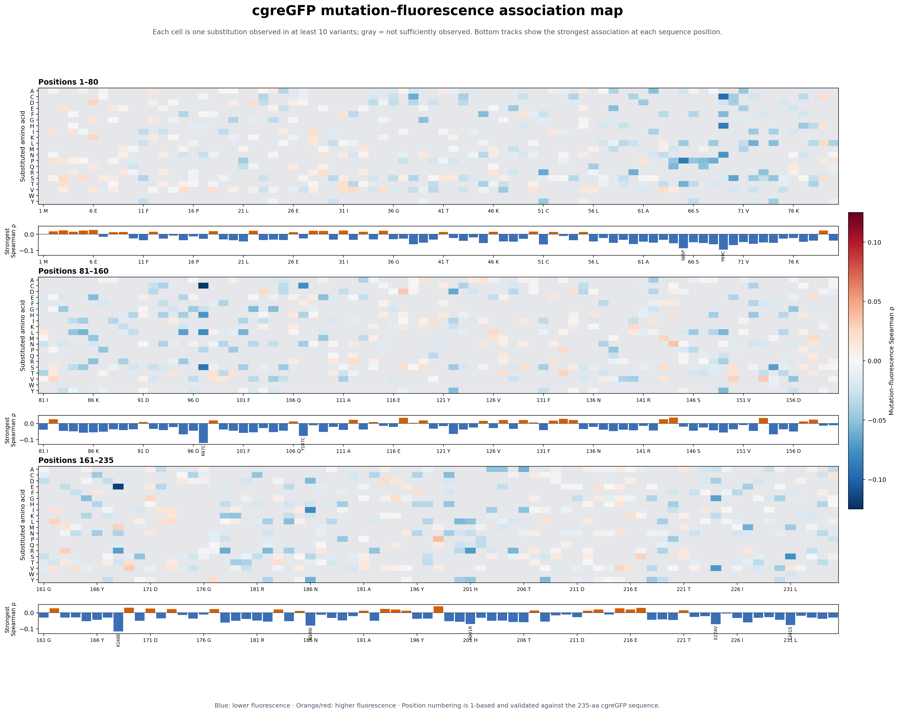
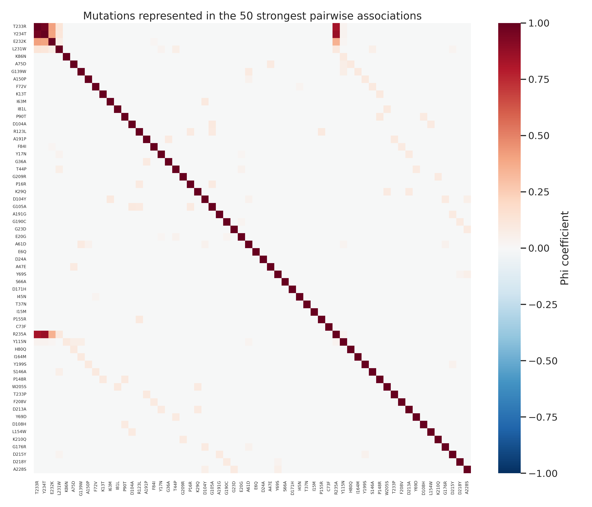
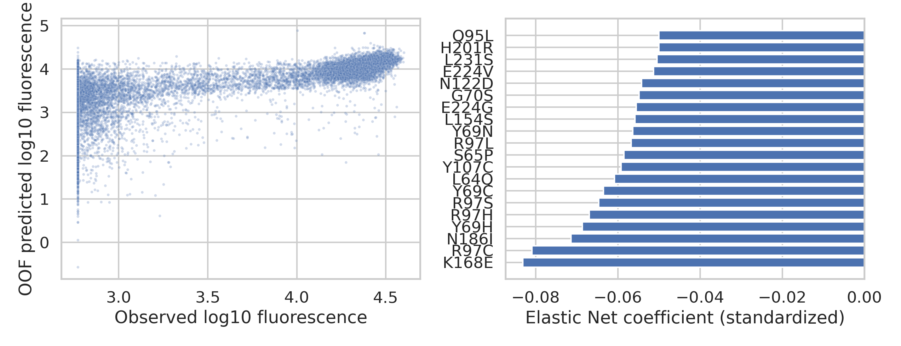

# Executive report: mutation associations with cgreGFP fluorescence

## Executive summary

We analyzed **24,515 cgreGFP variants** containing **1,651 distinct amino-acid substitutions**. Mutations were tested individually for association with fluorescence, mutation pairs were tested for co-occurrence, and Elastic Net models measured how well the complete mutation pattern predicts fluorescence.

The strongest signals are predominantly **loss-of-fluorescence substitutions**. Mutations around positions **65–69, 97, 107, 168, 186, and 231** repeatedly show negative associations. Positive associations exist but have smaller univariate effect sizes. The models predict held-out variants well, showing that the combined mutation pattern contains substantial fluorescence information.



## What we did

1. Converted each variant into a binary vector indicating which substitutions are present.
2. Log10-transformed fluorescence and fitted a two-component Gaussian mixture. The intersection between the two fitted modes, **log10 3.610** or **4,076 raw units**, defines active versus inactive fluorescence. This agrees with **95.7%** of the existing ProteinGym binary labels.
3. For each mutation, calculated an active/inactive odds ratio and Fisher exact test, plus point-biserial and Spearman correlations with continuous fluorescence. Each test family was FDR-corrected with Benjamini–Hochberg.
4. For mutation pairs observed often enough for stable analysis, calculated phi correlation, Fisher exact p-values, and global FDR q-values.
5. Evaluated Elastic Net logistic and linear models with nested **5-fold outer / 3-fold inner cross-validation**. All reported performance is based on out-of-fold predictions.

## Formulas and computation

### 1. Mutation indicator matrix

For every variant \(v\) and specific substitution \(m\), we constructed:

```text
X[v,m] = 1  if mutation m is present in variant v
X[v,m] = 0  otherwise
```

Thus, `A42V` is a different feature from `A42T`. The matrix contains one row per variant and one column per observed substitution. Mutation labels and sequence positions were checked against the reconstructed 235-aa wild-type cgreGFP sequence using **1-based indexing**.

The continuous response was:

```text
y[v] = log10(raw fluorescence[v])
```

Spearman correlation is unchanged if raw fluorescence is used because log10 is strictly monotonic and therefore preserves ranks.

### 2. Active/inactive threshold

We fitted two Gaussian components to log10 fluorescence. One component represents the low-fluorescence mode and the other the high-fluorescence mode. The automatic threshold is the value \(t\) where their posterior probabilities are equal:

```text
P(low component | y=t) = P(high component | y=t)
active[v] = 1 if y[v] >= t, otherwise 0
```

For this assay, \(t=3.610\), corresponding to 4,076 raw fluorescence units. This threshold follows the observed bimodal distribution rather than copying the supplied ProteinGym binary label.

### 3. Mutation association with binary activity

For each mutation, variants were arranged in a 2×2 contingency table:

| | Active | Inactive |
|---|---:|---:|
| Mutation present | \(a\) | \(c\) |
| Mutation absent | \(b\) | \(d\) |

The odds ratio was:

```text
OR = (a × d) / (b × c)
```

An odds ratio above 1 means the mutation is enriched among active variants; below 1 means it is enriched among inactive variants. Fisher's exact test supplied an exact p-value for the same table. Infinite or zero odds ratios can occur when one cell is zero.

### 4. Mutation association with continuous fluorescence

The point-biserial correlation compares mean log10 fluorescence with and without a mutation:

```text
r_pb = (mean(y | X=1) - mean(y | X=0)) / sd(y)
       × sqrt(n1 × n0 / n²)
```

This is Pearson correlation between a binary mutation indicator and continuous log10 fluorescence.

Spearman correlation was computed independently for every mutation:

```text
rho_m = Pearson correlation(X[:,m], rank(y))
```

Equivalently, it asks whether variants containing mutation \(m\) tend to occupy higher or lower fluorescence ranks than variants without it. Positive rho means higher fluorescence ranks and negative rho means lower ranks. This is an **unadjusted association across combinatorial variants**: other mutations remain present and can confound the result.

Point-biserial and Spearman p-values were calculated from their correlation test statistics. Fisher, point-biserial, and Spearman p-values were each corrected as separate test families using Benjamini–Hochberg false-discovery-rate control:

```text
ordered q(i) = min over j>=i of [p(j) × M / j]
```

where \(M\) is the number of mutations tested. A q-value estimates significance after accounting for the large number of simultaneous mutation tests.

### 5. Mutation–mutation association

For two mutations A and B, the phi coefficient is Pearson correlation between their two binary indicator columns. Using counts \(n11\) (both present), \(n10\) (only A), \(n01\) (only B), and \(n00\) (neither):

```text
phi = (n11 × n00 - n10 × n01)
      / sqrt[(n11+n10)(n01+n00)(n11+n01)(n10+n00)]
```

Phi ranges from −1 to +1. Positive values indicate co-occurrence, values near zero indicate little association, and negative values indicate mutual avoidance. Pairwise Fisher exact tests and Benjamini–Hochberg q-values were also computed. Only mutations observed in at least 10 variants entered this analysis.

Phi measures **co-occurrence, not fluorescence and not epistasis**. Strong phi can result from library construction, shared ancestry, or mutations introduced as a block.

### 6. Multivariate Elastic Net models

Mutations observed in at least 5 variants were included as predictors. Features were standardized within the modeling pipeline. Elastic Net combines L1 sparsity with L2 shrinkage:

```text
penalty(beta) = lambda × [alpha × sum(|beta|)
                         + (1-alpha)/2 × sum(beta²)]
```

The classification model minimized logistic loss plus this penalty and predicted active/inactive fluorescence. The regression model minimized squared error plus the same type of penalty and predicted log10 fluorescence.

Evaluation used nested cross-validation:

1. Split the data into five outer folds.
2. Within each outer training set, use three-fold cross-validation to choose regularization strength and L1/L2 mixing.
3. Fit the selected model on that outer training set.
4. Predict the untouched outer test fold.
5. Pool the five out-of-fold predictions and calculate ROC-AUC, R², and Spearman correlation.

This prevents the test fold from influencing hyperparameter selection. Final coefficient rankings come from a separately tuned descriptive model fitted to the full dataset; predictive performance comes only from out-of-fold predictions.

## Main findings

### Individual mutations

Among the **1,123 substitutions observed in at least 10 variants**, **577** have a Spearman FDR q-value below 0.05 and **509** have a Fisher FDR q-value below 0.05. Statistical significance is common because the dataset is large; correlation magnitude and recurrence across substitutions at a position are more useful for prioritization.

Strongest negative associations: **R97C** (ρ=-0.121), **K168E** (ρ=-0.116), **Y69C** (ρ=-0.095), **R97S** (ρ=-0.091), **S65P** (ρ=-0.087), **Y69H** (ρ=-0.087).

Strongest positive associations: **L198P** (ρ=0.039), **Y144N** (ρ=0.035), **N117D** (ρ=0.034), **I153V** (ρ=0.033), **A169V** (ρ=0.031), **K163R** (ρ=0.030).

The strongest positive correlation is only **ρ=0.039**, compared with **ρ=-0.121** for the strongest negative association. This library therefore provides clearer evidence for fluorescence-disrupting mutations than for individually beneficial mutations.

### Mutation–mutation associations

We tested **630,003 mutation pairs** among 1,123 substitutions observed at least 10 times. Only **3 pairs** meet the prespecified strong-pair definition, |phi| ≥ 0.5 and Fisher q < 0.05. They connect **T233R, Y234T, and R235A** (phi 0.83–0.96), indicating a tightly linked C-terminal mutation block. This likely reflects library design or jointly introduced variants and should not automatically be interpreted as biochemical interaction.



### Multivariate prediction

- Active/inactive Elastic Net ROC-AUC: **0.962**
- Continuous log10-fluorescence Elastic Net R²: **0.601**
- Continuous prediction Spearman ρ: **0.848**



These values show strong predictive signal, but they do not prove that every selected coefficient is causal. Linked mutations, unequal library sampling, and epistasis can redistribute coefficients between correlated substitutions.

## Recommended interpretation

- Use the sequence map to prioritize positions with repeated negative signals across several substitutions.
- Treat the positive mutations as candidates for experimental validation rather than confirmed brightness improvements.
- Validate candidate substitutions individually or in controlled backgrounds before making mechanistic claims.
- For publication, describe these results as **associations in a combinatorial library**, not single-mutation causal effects.

## Files

- `cgre_sequence_mutation_heatmap.png`: sequence-level substitution map.
- `position_association_summary.csv`: strongest association and tested substitutions at every sequence position.
- `mutation_fluorescence_associations.csv`: complete univariate mutation results.
- `mutation_mutation_associations.csv.gz`: complete pairwise results.
- `elastic_net_mutation_coefficients.csv` and `elastic_net_oof_predictions.csv`: multivariate results.
- `summary.json`: machine-readable settings and performance.

The reproducible analysis commands are documented in `README.md`.
